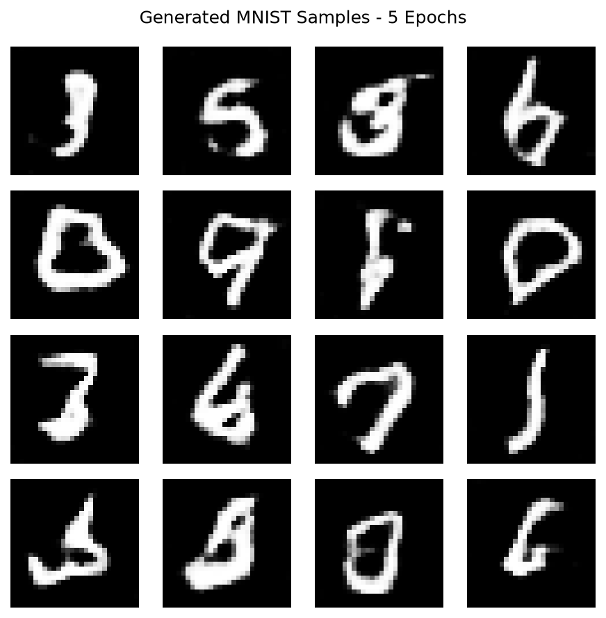
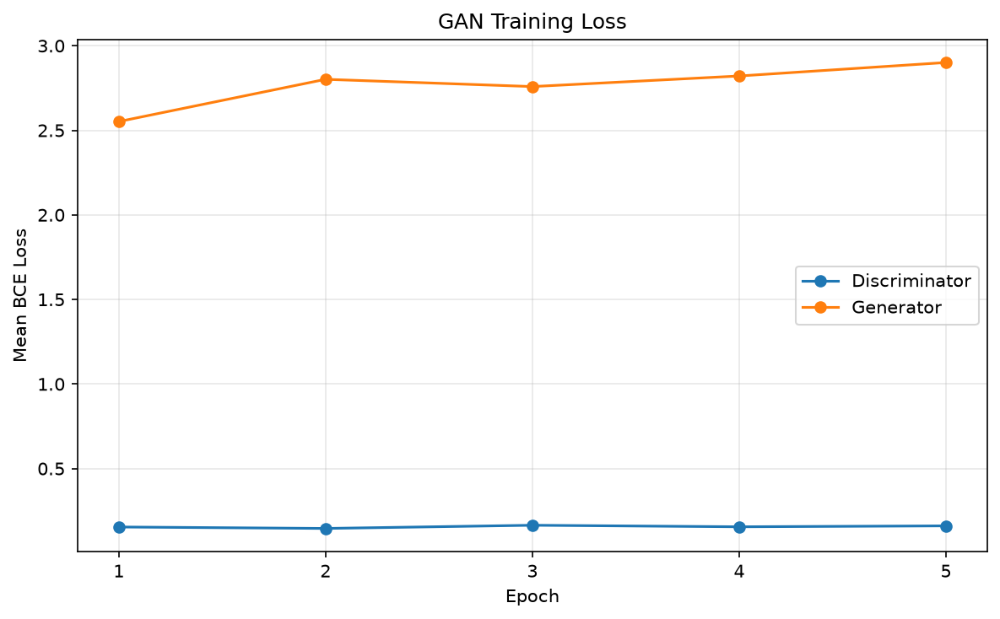

# FastAPI Text Generation, Word Embeddings, and Image Models

This project extends the class FastAPI application with word embeddings, CNN image classification, LSTM text generation, and Assignment 3 MNIST GAN image generation.

## Setup

From the repository root, install dependencies and download the English vector model:

```bash
uv sync
uv run python -m spacy download en_core_web_md
```

```bash
uv run fastapi dev app/main.py
```

Interactive API documentation:
http://127.0.0.1:8000/docs

## Endpoints

- GET /: Returns a greeting.
- POST /generate: Generates text using the bigram model.
- GET /embedding?word=love: Returns a word and its embedding.
- POST /classify: Classifies an uploaded image using the trained CNN.
- POST /generate_with_rnn: Generates text using the trained LSTM.
- GET /generate_with_gan: Returns a PNG grid of generated MNIST digits.

The embedding endpoint uses spaCy's en_core_web_md model.
A successful response contains:
- word: The queried word.
- dimension: The vector length (300).
- embedding: The complete list of vector values.

## Input Validation

For the embedding endpoint:
- Empty or whitespace-only input: HTTP 400.
- Input containing multiple tokens: HTTP 400.
- A token without a vector: HTTP 404.
- Missing word parameter: HTTP 422.

GAN query parameters: `num_samples` must be between 1 and 64; `seed` must be between 0 and 2147483647. Invalid values return HTTP 422.

## Manual Checks 
- love: Returned a 300-dimensional embedding.
- Empty input: Returned "Please enter a word."
- hello world: Returned "Please enter a single word."
- GAN: The user tested the Docker endpoint on port 8003 through Swagger UI. It returned HTTP 200, content type image/png, and a 16-image digit grid.


# With Docker
Docker must be installed and running.

From the project root, build the image:

```bash
docker build -t sps-genai:assignment3 .
```

Start the container:

```bash
docker run --rm -p 8003:8000 sps-genai:assignment3
```

The image includes the Python dependencies and spaCy's
en_core_web_md model. Internet access is required during the build.

Test the embedding endpoint:
http://127.0.0.1:8003/embedding?word=love

Interactive API documentation:
http://127.0.0.1:8003/docs

A successful embedding response contains the queried word,
dimension 300, and the complete embedding list.

Test the GAN endpoint:
http://127.0.0.1:8003/generate_with_gan?num_samples=16&seed=42

The image copies `app`, `helper_lib`, and `models`. Included pretrained
weights allow inference without retraining or downloading MNIST.
The existing application also requires its CNN and LSTM checkpoint files.
These are included in the repository.

Press Ctrl+C in the terminal to stop the container.

# CNN Image Classification
## Model architecture

Input: RGB images resized to 64 × 64.
- Conv2d: 3 → 16 channels, kernel 3, stride 1, padding 1 → ReLU → MaxPool2d(2, 2).
- Conv2d: 16 → 32 channels, kernel 3, stride 1, padding 1 → ReLU → MaxPool2d(2, 2).
- Flatten → Linear(8192, 100) → ReLU → Linear(100, 10).

Training and inference use identical preprocessing: resize to 64 × 64, convert to a tensor, and normalize each channel with mean and standard deviation 0.5.

## Training
From the project root, run:

```bash
uv sync
uv run python -m app.train_cnn
```

Uses 50,000 training images and 10,000 test images, with 5 epochs, batch size 64, Adam (learning rate 0.001), and CrossEntropyLoss.
Recorded results: 74.78% final epoch training accuracy; 64.97% test accuracy. Results may vary when retraining.
Weights: models/cifar10_cnn.pt
Metrics: models/training_metrics.json

## API

POST /classify accepts an image in the multipart field file:

```bash
curl -X POST "http://127.0.0.1:8003/classify" \
  -F "file=@example.jpg"
```

Example response:

```json
{
  "class": "bird",
  "class_id": 2,
  "confidence": 0.5432
}
```

Classes: airplane, automobile, bird, cat, deer, dog, frog, horse, ship, truck. Confidence is a softmax score, not a guarantee of correctness.
Responses: **200** for successful prediction, **400** for an invalid image, **422** for a missing file. Prediction was verified in Docker.

# MNIST GAN

## Model Architecture

Generator:
- Input: Noise of shape (batch_size, 100).
- Linear: 100 -> 7 * 7 * 128, then reshape to (batch_size, 128, 7, 7).
- ConvTranspose2d: 128 -> 64, kernel 4, stride 2, padding 1 -> 14 x 14.
- BatchNorm2d and ReLU.
- ConvTranspose2d: 64 -> 1, kernel 4, stride 2, padding 1 -> 28 x 28.
- Tanh.

Discriminator:
- Input: Grayscale images of shape (batch_size, 1, 28, 28).
- Conv2d: 1 -> 64, kernel 4, stride 2, padding 1 -> LeakyReLU(0.2).
- Conv2d: 64 -> 128, kernel 4, stride 2, padding 1 -> BatchNorm2d -> LeakyReLU(0.2).
- Flatten -> Linear(128 * 7 * 7, 1) -> Sigmoid.

## Training

Open `assignment3_test.ipynb` from the repository root in VS Code with a
Python environment containing torch, torchvision, matplotlib, and ipykernel.
For a local training environment, install the notebook dependencies with:

```bash
uv pip install --python .venv/bin/python matplotlib ipykernel
```

Run the notebook cells in order. The initialization cell creates a new model;
rerunning it resets training. MNIST is downloaded to `data/` on first use.

- Dataset: 60,000 MNIST training images, 28 x 28 grayscale.
- Normalization: Pixel values mapped to [-1, 1].
- Batch size: 64.
- Completed training: 5 epochs (one epoch followed by four additional epochs).
- Loss: Binary cross-entropy (BCELoss).
- Optimizers: Separate Adam optimizers, learning rate 0.0002, betas (0.5, 0.999).
- Updates: Alternate discriminator and generator updates; detach fake images
  during the discriminator update.

The workflow follows the course GAN notebook's separate networks, alternating
updates, loss logging, and fixed-noise visualization. The assignment-specific
probability discriminator uses BCE instead of the notebook's Wasserstein loss,
RMSprop, repeated critic updates, and weight clipping.

Checkpoint: `models/assignment3_mnist_gan.pth` (approximately 3.5 MB).
It contains both networks' state dictionaries, latent dimension, completed
epoch count, and training history. Optimizer states are not included, so this
checkpoint supports inference but not exact optimizer-state resumption.

## API

`GET /generate_with_gan` returns a PNG image grid.

| Parameter | Default | Valid range | Meaning |
| --- | --- | --- | --- |
| num_samples | 16 | 1-64 | Number of generated images |
| seed | 42 | 0-2147483647 | Random seed for repeatable sampling |

The model is unconditional: the seed does not select a digit class.
Inference uses CPU for portability. Each generated image is 28 x 28 and is
enlarged to 112 x 112 for display. With 16 samples, the grid is 488 x 488 pixels.

```bash
curl --fail \
  "http://127.0.0.1:8003/generate_with_gan?num_samples=16&seed=42" \
  --output generated_digits.png
```

Successful requests return HTTP 200 and `image/png`; invalid parameters return
HTTP 422. Use `/docs` to test the endpoint interactively.

## Results and Limitations

Several generated samples resemble handwritten digits, while some remain
ambiguous or distorted after five epochs. Loss curves alone do not establish
convergence or image quality. No quantitative generation-quality score is reported.





# Files


- app/cnn_model.py: architecture.
- app/image_data.py: preprocessing and data loading.
- app/train_cnn.py: training and evaluation.
- app/cnn_api.py: prediction endpoint.
- app/main.py: FastAPI application.
- models/: weights and metrics.

- app/gan_api.py: GAN inference endpoint and PNG grid rendering.
- app/lstm_model.py: LSTM used by the existing text-generation endpoint.
- helper_lib/assignment3_gan.py: Assignment 3 generator and discriminator.
- helper_lib/assignment3_trainer.py: GAN training loop.
- helper_lib/data_loader.py: Data loaders, including MNIST.
- assignment3_test.ipynb: Training workflow and saved outputs.
- models/assignment3_mnist_gan.pth: Trained Assignment 3 checkpoint.
- models/module7_lstm.pth: Checkpoint required by the existing LSTM endpoint.
- assignment3_results/: Generated image grid and training loss plot.
- Dockerfile: Container build and API startup.
- pyproject.toml and uv.lock: Application dependencies.

The theory answers for Assignment 3 are prepared separately.
